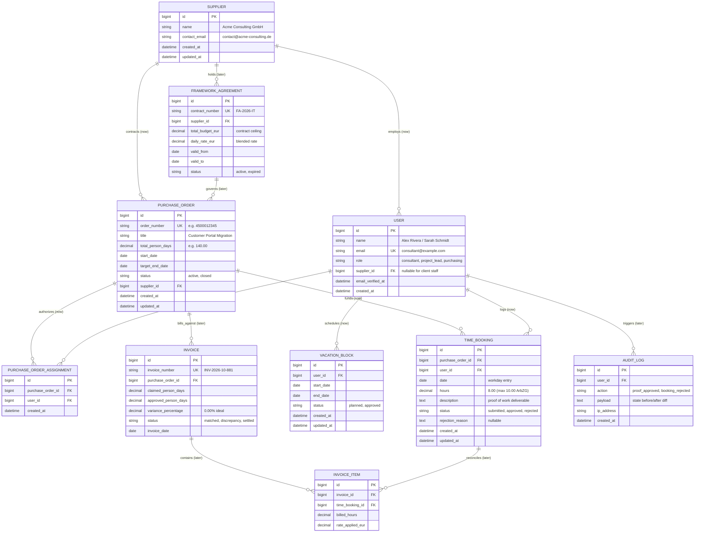

# Domain Model & Entity Relationship Architecture

> See [guide 2.3 (Model the domain)](guide.md#23-model-the-domain) and [scoring.md (Criterion 1 · Persistence and data model)](scoring.md#criterion-1--persistence-and-data-model-02).

---

## 1. Glossary

| Term | German | Meaning |
| --- | --- | --- |
| **PurchaseOrder** | Einzelbestellung | Client's formal purchase order against an external supplier, containing total authorized budget in Person-Days (PD), active dates, and burn tracking. |
| **Supplier** | Dienstleister | External consulting agency providing specialist engineering or advisory headcount to the client. |
| **User** | Benutzer | System principal assigned to one of three authorization tiers: `consultant` (supplier side), `project_lead` (client steering), or `purchasing` (procurement & finance). |
| **TimeBooking** | Zeitbuchung | Granular daily time entry logged by a consultant against an authorized purchase order. Subject to strict ArbZG § 3 maximum ceilings (10.0h). |
| **VacationBlock** | Abwesenheit / Urlaub | Scheduled consultant absence or PTO period, consumed by the predictive runway forecast engine to adjust depletion dates forward. |
| **Person-Day (PD)** | Personentag (PT) | Standard contractual capacity unit (1.00 PD = 8.00 hours). |
| **Runway** | Budgetreichweite | Forecasted calendar date when an active order's remaining person-day capital will exhaust, calculated from rolling 4-week burn pace, calendar weekends, and planned absences. |
| **FrameworkAgreement** | Rahmenvertrag *(later)* | Umbrella corporate procurement contract establishing blended rates, maximum financial ceilings, and validity periods for call-offs. |
| **Invoice** | Lieferantenrechnung *(later)* | Vendor billing document verified via 3-way matching against client-approved timesheets before release for settlement. |
| **AuditLog** | Revisionsprotokoll *(later)* | Immutable statutory audit trail recording proof-of-work approvals, timesheet rejections, and rate adjustments. |

---

## 2. Entity Relationship Diagram (ERD)

Entities currently implemented in production SQLite migrations are marked **`(now)`**.  
Entities designed for the next expansion stage (satisfying Criterion 1 for full marks) are marked **`(later)`**.

---

## 3. Data Dictionary & Implementation Matrix

| Table / Entity | Implementation State | Model Class | Migration File |
| --- | --- | --- | --- |
| `suppliers` | **Core (now)** | [`App\Models\Supplier`](../app/Models/Supplier.php) | [`2026_10_30_000001_create_suppliers_table.php`](../database/migrations/2026_10_30_000001_create_suppliers_table.php) |
| `users` | **Core (now)** | [`App\Models\User`](../app/Models/User.php) | [`0001_01_01_000000_create_users_table.php`](../database/migrations/0001_01_01_000000_create_users_table.php) & [`2026_10_30_000002_add_role_and_supplier_id_to_users_table.php`](../database/migrations/2026_10_30_000002_add_role_and_supplier_id_to_users_table.php) |
| `purchase_orders` | **Core (now)** | [`App\Models\PurchaseOrder`](../app/Models/PurchaseOrder.php) | [`2026_10_30_000003_create_purchase_orders_table.php`](../database/migrations/2026_10_30_000003_create_purchase_orders_table.php) |
| `purchase_order_assignments` | **Core (now)** | Pivot: `assignedConsultants()` | [`2026_10_30_000004_create_purchase_order_assignments_table.php`](../database/migrations/2026_10_30_000004_create_purchase_order_assignments_table.php) |
| `time_bookings` | **Core (now)** | [`App\Models\TimeBooking`](../app/Models/TimeBooking.php) | [`2026_10_30_000005_create_time_bookings_table.php`](../database/migrations/2026_10_30_000005_create_time_bookings_table.php) |
| `vacation_blocks` | **Core (now)** | [`App\Models\VacationBlock`](../app/Models/VacationBlock.php) | [`2026_10_30_000006_create_vacation_blocks_table.php`](../database/migrations/2026_10_30_000006_create_vacation_blocks_table.php) |
| `framework_agreements` | **Expansion (later)** | Documented design | Planned migration `stage_2_procurement` |
| `invoices` | **Expansion (later)** | Documented design | Planned migration `stage_2_procurement` |
| `invoice_items` | **Expansion (later)** | Documented design | Planned migration `stage_2_procurement` |
| `audit_logs` | **Expansion (later)** | Documented design | Planned migration `stage_3_compliance` |

---

## 4. Business Logic & Algorithmic Specifications

### 1. Budget Runway Depletion Engine

- **Used Person-Days**: $\text{Total Approved Hours} \div 8.00$.
- **Remaining Budget**: $\text{Total Budget PD} - \text{Used PD}$.
- **Rolling Burn Velocity**: Average PD consumed per active calendar week over the prior 4 weeks:
  $$\text{Burn Velocity (PD/wk)} = \frac{\sum_{w=1}^{4} \text{PD}_w}{4}$$
- **Runway Exhaustion Date**: Evaluated day-by-day starting from current system date ($t_0$). Skips non-working days (Saturdays, Sundays) and active consultant `vacation_blocks`. Deducts daily burn pace until remaining PD reaches $0.00$.
- **4-Week Procurement Re-order Radar**:
  $$\text{Re-Order Required} \iff \text{Days to Exhaustion} \le 28 \text{ days} \lor \text{Exhaustion Date} \le \text{Target End Date}$$

### 2. ArbZG Labor Law Validation Ceilings

- **Strict 10-Hour Daily Ceiling (ArbZG § 3)**:
  $$\sum \text{hours}_{\text{user}, \text{date}} \le 10.00\text{h}$$
  Any booking exceeding $10.00\text{h}$ across all orders for a single calendar date is rejected server-side with an explicit validation error.
- **Assignment Guardrail**: A consultant can only book hours against purchase orders where an active record exists in `purchase_order_assignments`.
