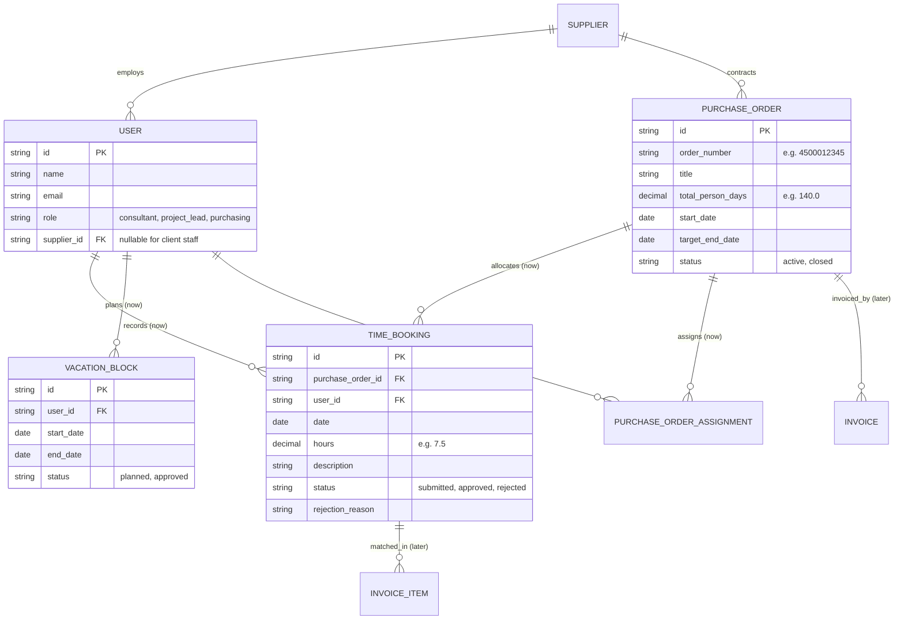

# Domain model

> See [guide 2.3](guide.md#23-model-the-domain).

## Glossary

| Term | German | Meaning |
|---|---|---|
| **PurchaseOrder** | Bestellung | Client's formal order with an external supplier, containing a total budget in person-days (PD), start date, target completion date, and budget burn tracking. |
| **Supplier** | Dienstleister | The external consulting company supplying specialists to the client. |
| **User** | Benutzer | System user with an assigned role: `consultant` (supplier side), `project_lead` (client side), or `purchasing` (finance/procurement). |
| **TimeBooking** | Zeitbuchung | An individual booking record for hours worked on an order, with a date, duration, description, and status (`submitted`, `approved`, `rejected`). |
| **VacationBlock** | Urlaubszeitraum | Planned absences/vacations for a consultant, used by the runway calculation algorithm to project accurate burn rates. |
| **Invoice** | Rechnung | Supplier invoice submitted for payment, matched against approved bookings. |
| **Person-Day (PD)** | Personentag (PT) | Standard unit of consulting work (1 PD = 8 hours). |
| **Runway** | Reichweite | The forecasted calendar date when the purchase order's budget will be exhausted, factoring in current burn rate, upcoming vacations, and public holidays. |

## Entity relationship diagram

Entities we **build now** are marked `(now)`, entities of the **next expansion stage** `(later)`.

## Business Rules & Calculations

### 1. Budget & Runway Calculations
- **Used Person-Days**: $\text{Total Approved Hours} \div 8.0$.
- **Remaining Budget**: $\text{Total Budget PD} - \text{Used PD}$.
- **Average Weekly Pace**: Running average of person-days booked per active calendar week over the last 4 weeks.
- **Runway Forecast Date**: Starting from today, iterating day by day (skipping weekends, German public holidays, and consultant's planned `VACATION_BLOCK`s) until remaining person-days reach zero.
- **Procurement Alert**: If $\text{Runway Date} \le \text{Target End Date}$ AND $\text{Days to Runway} \le 28 \text{ days}$ (4-week purchasing lead time), flag as **Re-Order Alert (High Priority)**.

### 2. Legal Compliance Guardrails (German ArbZG)
- **Daily Max Limit**: A consultant cannot log $> 10$ hours on any single calendar date (strict ArbZG § 3 ceiling).
- **Standard Working Day Alert**: A warning is surfaced if daily hours exceed 8 hours without compensatory rest.
- **Rest Day Rule**: Bookings on Sundays and German statutory public holidays are rejected or flagged for special authorization (ArbZG § 9).
